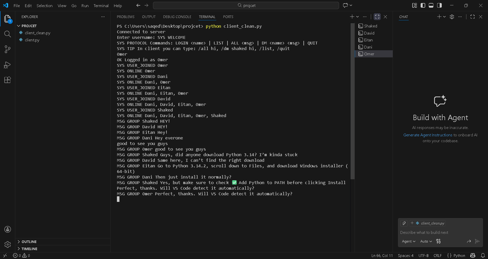
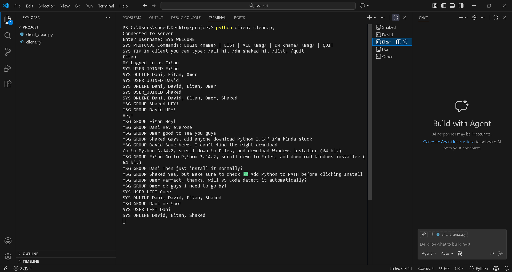
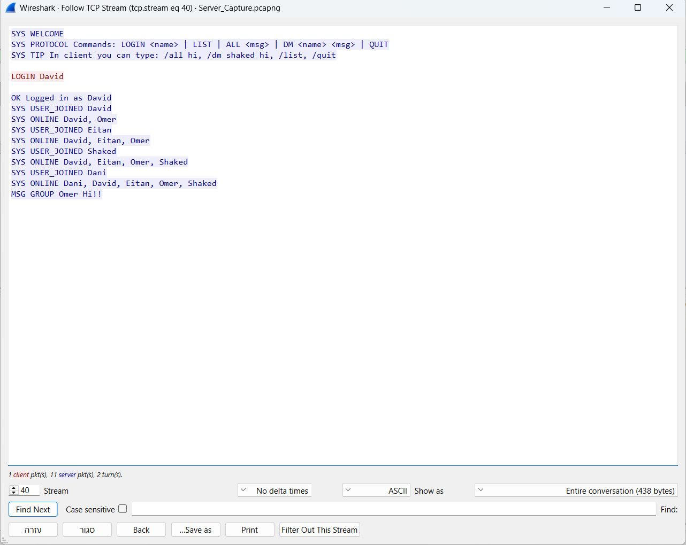

# Python TCP Chat

A terminal chat application built with Python sockets and threads for a networking study project. One server handles multiple clients, with group messages, direct messages and an online-user list.

Browse the [project report](docs/tcp-chat-project-report.md), [network analysis](docs/network/README.md) and screenshots below directly on GitHub. Original Word, Excel and packet-capture files are also available.

## Screenshots

### Group chat

Multiple connected clients exchange messages through the server.



<details>
<summary>Client disconnection and TCP stream inspection</summary>

The client receives departure notifications and an updated online-user list.



Wireshark's Follow TCP Stream view shows the plaintext application protocol.



</details>

These screenshots document the original coursework session. The client filename visible in the terminal differs from the current repository's `client.py`.

## How it works

```text
Client A ---- TCP ----+
                     |
                  Server ---- shared client registry
                     |
Client B ---- TCP ----+
```

The server creates a thread for each connection. A lock protects the username-to-socket registry. Messages are UTF-8 text delimited by newlines; receive loops retain incomplete lines between socket reads.

## Run locally

Requires **Python 3.10 or newer**. Both programs use only the standard library, so no pip packages are needed.

For a demo on one computer, set these constants before running:

- In `client.py`: `SERVER_IP = "127.0.0.1"`
- In `server.py`: `HOST = "127.0.0.1"`

The checked-in client address is from the original local network. Both programs use port `50000`; the server's checked-in `0.0.0.0` address listens on all network interfaces.

Start the server:

```bash
python server.py
```

Open two more terminals and run this in each:

```bash
python client.py
```

Choose a different username for each client. For the existing client's direct-message behavior, use uppercase names such as `ALICE` and `BOB`.

## Client commands

| Input | Behavior |
| --- | --- |
| `Hello everyone` | Sends a group message, preserving its case |
| `/list` | Lists connected users |
| `/dm BOB Hello` | Sends a direct message to BOB |
| `/quit` | Closes the client |

The server protocol accepts `LOGIN <name>`, `LIST`, `ALL <message>`, `DM <name> <message>` and `QUIT`. Responses use `SYS`, `OK`, `ERR` and `MSG` prefixes.

**Client limitation:** slash commands currently uppercase the entire line, including the direct-message recipient and message body. Usernames are case-sensitive on the server. Ordinary messages avoid this conversion.

## Repository contents

| File | Purpose |
| --- | --- |
| [server.py](server.py) | Connection handling, user registry and message routing |
| [client.py](client.py) | Terminal input and background receive loop |
| [Project report](docs/tcp-chat-project-report.md) | Read the original Hebrew report in the browser |
| [Network analysis](docs/network/README.md) | Worksheet previews and CSV tables that open on GitHub |
| [Screenshots](docs/images/) | Group chat, disconnection and Wireshark TCP stream |
| [Word report](docs/tcp-chat-project-report.docx) | Original report for download |
| [Packet capture](docs/network/server-traffic-capture.pcapng) | Original capture for Wireshark |
| [Traffic analysis workbook](docs/network/traffic-analysis.xlsx) | Original Excel workbook with HTTP message examples |
| [Traffic data workbook](docs/network/traffic-data.xlsx) | Original Excel workbook with TCP packet data |

The report and worksheet previews need no download. Word and Excel files preserve the original documents; the packet capture requires a tool such as Wireshark. These materials are not application dependencies.

## Scope and next steps

This is a local networking exercise. It has no encryption, password authentication, persistent message history or automated test suite. A username identifies a connection; it does not verify a person's identity.

The next improvements would be to preserve command arguments, make host and port configurable at launch, add protocol tests, and report connection errors instead of suppressing them.

[More projects](https://github.com/omerbenguigui)
